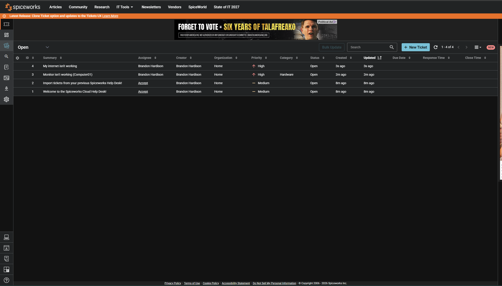
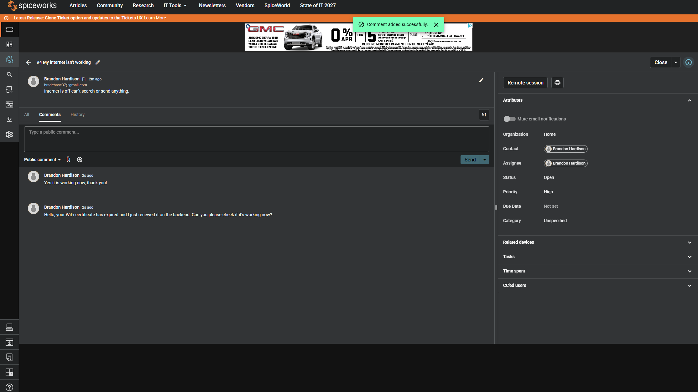
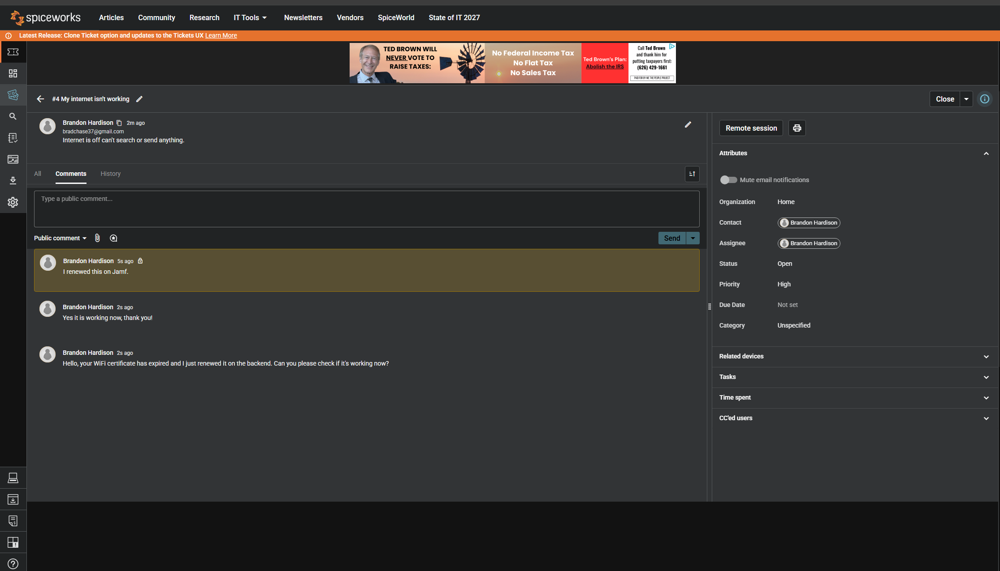

# Spiceworks Help Desk Ticketing System Lab

## Overview
This lab demonstrates practical experience with Spiceworks Cloud Help Desk, focusing on IT support ticket management, incident tracking, and technical documentation in a simulated help desk environment.

## Technologies & Skills
- **Platform:** Spiceworks Cloud Help Desk
- **IT Support:** Incident Management, Ticket Troubleshooting, Issue Resolution
- **Technical Skills:** Ticket Prioritization, Status Tracking, Technical Documentation
- **ITSM Concepts:** Help Desk Operations, Service Request Management

## Lab Implementation
1. **Help Desk Setup:** Accessed and navigated the Spiceworks ticketing environment.
2. **Ticket Creation:** Created simulated IT support tickets to document technical issues.
3. **Ticket Management:** Practiced organizing tickets by priority, status, and support requirements.
4. **Ticket Resolution:** Practiced updating ticket statuses and documenting resolutions.

## Screenshots

### 1. Help Desk Dashboard

### 2. Ticket Creation

### 3. Ticket Details & Management

### 4. Ticket Resolution

## Key Takeaways
- Gained hands-on familiarity with a professional IT ticketing platform.
- Practiced managing and tracking IT support requests throughout the ticket lifecycle.
- Strengthened technical documentation and incident management skills.
- Developed an understanding of structured IT Help Desk workflows.
